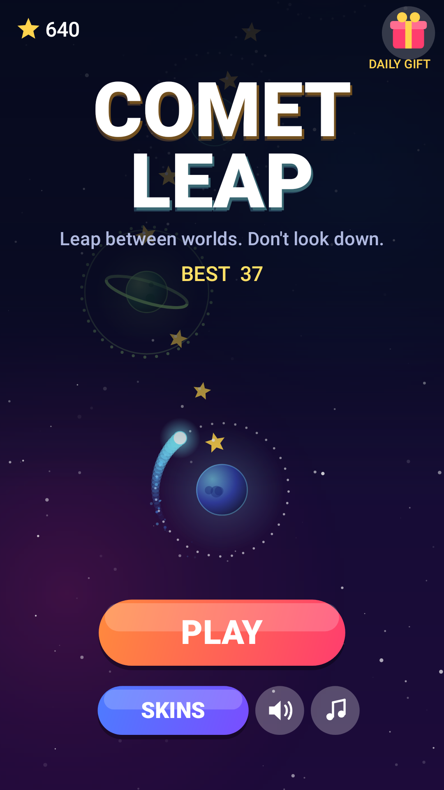
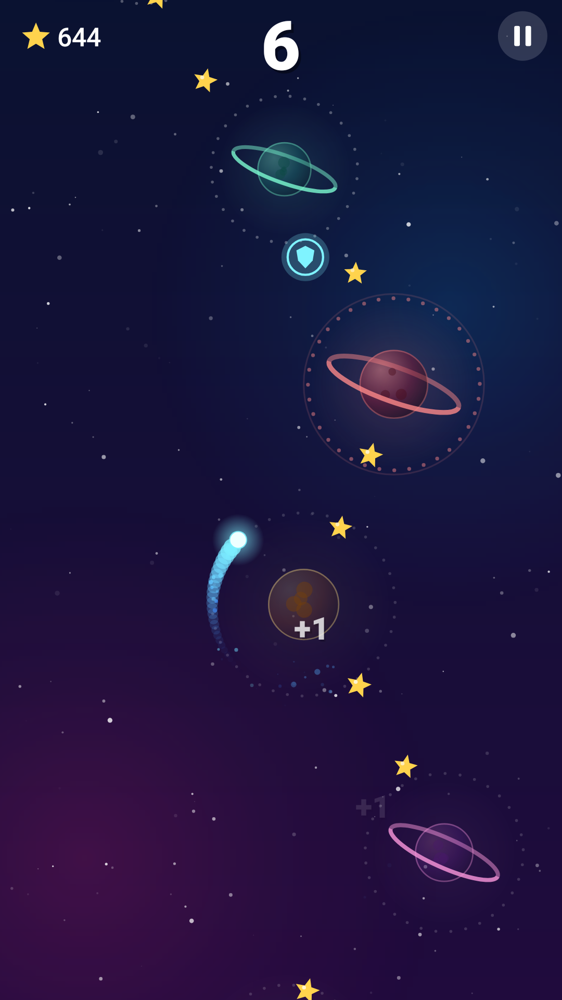
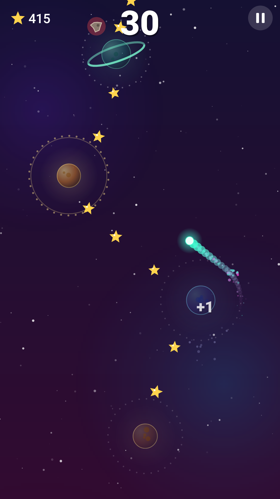
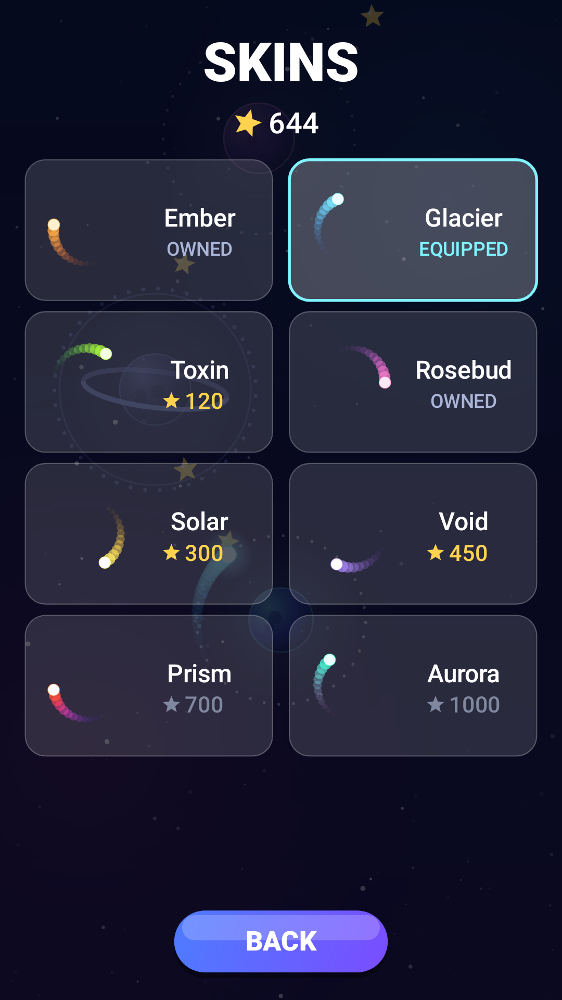

# ☄️ Comet Leap — جهش ستاره‌دنباله‌دار

A one-tap arcade game for Android. Your comet circles a planet; **tap** to leap off on the tangent and try to land in the next planet's orbit. Gravity bends your path, orbits decay, and space gets nastier the higher you climb.

<p align="center">
  
  
  
  
</p>

## Features
- **One-tap gameplay**, endlessly generated world with a smooth difficulty curve
- **Perfect leaps** (graze an orbit tangentially) chain into combo multipliers
- Real **gravity assists**, moving planets, **asteroid belts**, **black holes**
- Power-ups: **shield** & **star magnet**; a **continue** costs 30 ★ once per run
- **8 comet skins** to unlock with collected stars, a **daily gift**
- **Procedural audio**: every sound effect *and* a seamless 16-second synth soundtrack are generated in code at start-up
- Haptics, particles, screen-shake, slow-motion deaths, parallax starfield & nebulae
- **English + Persian (فارسی)**, RTL-ready
- Phones, tablets and foldables (wide screens get a centred play column — Android 16 ignores portrait locks on large screens)
- **~70 KB APK**, zero third-party dependencies, no ads, no tracking, no permissions, works offline

## Tech
Kotlin, a single `SurfaceView` with a hardware-accelerated `Canvas`, a fixed-step (120 Hz) simulation, and allocation-free particle pools. `minSdk 24`, `targetSdk 36`.

```
app/src/main/java/com/sepehrsun/cometleap/
├── MainActivity.kt      immersive full-screen, predictive back, lifecycle
├── GameView.kt          render thread, input queue, insets, haptics
├── PrefsStore.kt        SharedPreferences persistence
├── audio/Synth.kt       procedural SFX + music synthesiser
├── audio/AndroidSfx.kt  SoundPool + looping static AudioTrack
└── game/                platform-light game core (Game, Entities, Skins, …)
```

The game core is testable on the JVM: `GameplayTest` (Robolectric, native graphics) lets a bot play hundreds of planets across seeds, checks game-over/continue flows and the synthesiser, and **renders the real game to PNG** — that is where every image in `store/` comes from.

## Build
```bash
./gradlew testDebugUnitTest   # bot plays + regenerates store/ screenshots
./gradlew assembleDebug       # app/build/outputs/apk/debug/app-debug.apk
./gradlew bundleRelease       # app/build/outputs/bundle/release/app-release.aab
```
Requires JDK 17+ and the Android SDK (platform 36). CI (`.github/workflows/android.yml`) runs tests + lint and publishes the AAB/APK as build artifacts on every push.

## Publishing to Google Play — checklist
1. **Create your upload key** (once): `./scripts/create-upload-key.sh`. Back up the `.jks` and password somewhere safe. *Never commit them* (they're git-ignored).
2. **Build** `./gradlew bundleRelease` → `app/build/outputs/bundle/release/app-release.aab`
   *(or add the 4 secrets printed by the script to GitHub → Settings → Secrets → Actions, and download the signed AAB from the workflow run's artifacts).*
3. **Play Console** → Create app → name *Comet Leap*, type **Game**, **Free**.
4. **App signing**: accept *Play App Signing* (default) and upload the AAB to **Internal testing** first, then Closed/Production.
   - New personal developer accounts must run a **closed test with ≥12 testers for 14 days** before production access.
5. **Store listing** — everything is in `store/`:
   | Field | File |
   |---|---|
   | App name / short / full description (en-US, fa-IR) | `store/listing/<lang>/*.txt` |
   | App icon 512×512 | `store/icon_512.png` |
   | Feature graphic 1024×500 | `store/feature_graphic_1024x500.png` |
   | Phone screenshots (1080×1920) | `store/screenshots/01…06*.png` |
   | Tablet screenshots | `store/screenshots/07_tablet_menu.png`, `08_tablet_landscape.png` |
   - Category: **Arcade**. Tags: *Casual, Arcade, Space, One-tap*.
6. **Policy forms** (App content):
   - **Privacy policy URL** → publish `docs/privacy-policy.md` (e.g. enable GitHub Pages on `/docs`, or link the file on GitHub).
   - **Data safety** → *No data collected, no data shared*.
   - **Ads** → *No ads*. **In-app purchases** → none.
   - **Content rating** (IARC questionnaire) → no violence/gambling/user content → expected **Everyone / PEGI 3**.
   - **Target audience** → 13+ is the simplest choice (selecting under-13 brings Families policy requirements; the app would comply, but it's more paperwork).
   - **Government / news / financial / health** declarations → not applicable.
7. **Updates**: bump `versionCode` (+1) and `versionName` in `app/build.gradle.kts` for every upload.

## License
All code and generated assets © the repository owner.
